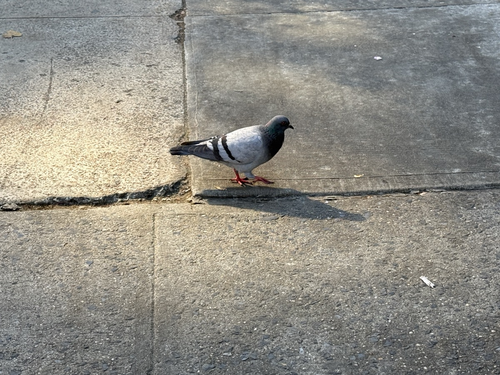
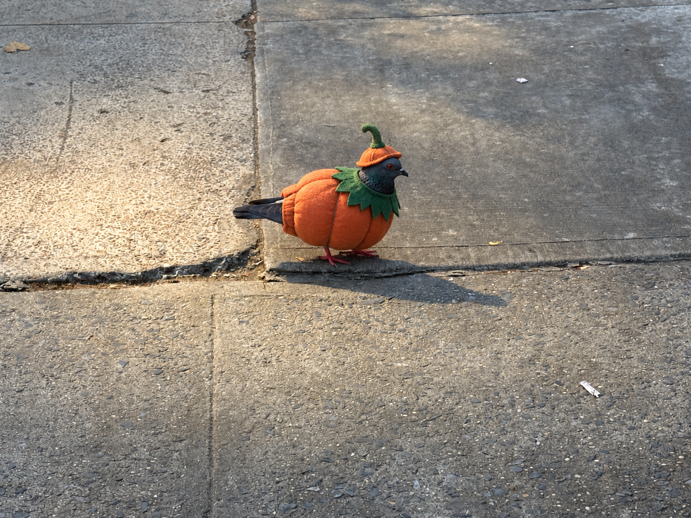

# ooo-photowalk-halloween

Snap a pigeon on your iPhone. A minute later it's back on your phone, photorealistically dressed for Halloween. Christmas lives in its own repo, `ooo-photowalk-xmas`.

<table>
  <tr>
    <th>Before</th>
    <th>After</th>
  </tr>
  <tr>
    <td></td>
    <td></td>
  </tr>
</table>

## How it works

1. **Post:** The **Post Pigeon** iOS Shortcut (share sheet → Post Pigeon) asks for a costume, converts the photo to JPEG, resizes it, strips GPS, and commits it to `pigeons/` through the GitHub Contents API. The costume rides in the filename: `pigeon-<timestamp>-bee.jpg`.
2. **Classify:** The push triggers a GitHub Action. [Typesafe](https://docs.typesafe.ai/images) (Jev) checks that the photo is a pigeon.
3. **Gate:** Not a pigeon? You get a "Pigeon not detected." push and the run stops, so nothing is spent on image generation.
4. **Direct:** The script looks up the chosen costume in `themes/halloween/direction.json`, then picks one of its props and captions. **homemade** (also the fallback for no or unknown costume) lets the model invent its own.
5. **Transform:** OpenAI's image edit endpoint dresses the pigeon using `themes/halloween/prompt.md`, filled with that direction.
6. **Deliver:** The result is committed to `transformed/halloween/`, and a [Bark](https://github.com/Finb/Bark) push shows the caption and opens the image when tapped.
7. **Browse:** Every transformed pigeon appears in the [gallery](https://vinceallenvince.github.io/ooo-photowalk-halloween/), an edge-to-edge feed served by GitHub Pages.

```
 iPhone
 ┌──────────────────────┐
 │ Photos → Share →     │
 │ "Post Pigeon"        │  JPEG · 1200px · no GPS
 │ (iOS Shortcut)       │
 └──────────┬───────────┘
            │ PUT /repos/.../contents/pigeons/pigeon-<timestamp>.jpg
            ▼
 GitHub repo ─────────────────────────────────────────────────────────────
 │  pigeons/*.jpg ──push──▶ GitHub Action: .github/workflows/transform.yml
 │                          scripts/transform.py
 │                               │
 │                               ▼
 │                     ┌───────────────────┐
 │                     │ Typesafe / Jev    │  is it a pigeon?             
 │                     │ (classify)        │──▶ classifications/<name>.json
 │                     └─────────┬─────────┘
 │                    pigeon? ───┴─── no
 │                      │              │
 │                      ▼              ▼
 │           ┌───────────────────┐   Bark: "Pigeon not detected."
 │           │ chosen costume +  │     └─ tap ─▶ original photo (raw URL)
 │           │ its caption       │
 │           └─────────┬─────────┘
 │                     ▼
 │           ┌───────────────────┐
 │           │ OpenAI image edit │  themes/halloween/prompt.md (template)
 │           └─────────┬─────────┘
 │                     ▼
 │           transformed/halloween/<name>.png ── commit + push
 │                     │
 └─────────────────────┼───────────────────────────────────────────────────
                       ├──▶ Bark: "New Halloween pigeon 🎃 · “<caption>”"
                       │      └─ tap ─▶ transformed image (raw URL)
                       │
                       └──▶ GitHub Pages gallery (index.html)
                              reads transformed/halloween/ via the GitHub API
                              vinceallenvince.github.io/ooo-photowalk-halloween/
```

## Repo layout

| Path | What it is |
|---|---|
| `pigeons/` | Originals, posted by the Shortcut |
| `classifications/` | Jev's answers and the chosen costume, one JSON per photo |
| `transformed/halloween/` | Dressed-up results (PNG) |
| `themes/halloween/prompt.md` | Image prompt template with `{{PLACEHOLDERS}}` |
| `themes/halloween/direction.json` | Title, and each costume's text, props, and captions |
| `scripts/transform.py` | Classify → gate → direct → transform |
| `.github/workflows/transform.yml` | Runs the script on every push to `pigeons/`, then commits and notifies |
| `index.html` | The gallery |

## Setup

Repository secrets (Settings → Secrets and variables → Actions):

| Secret | Used for |
|---|---|
| `OPENAI_API_KEY` | Image edit |
| `TYPESAFE_API_KEY` | Classification |
| `BARK_KEY` | Push notifications (the device key only, not the URL) |
| `REPLICATE_API_KEY` | FLUX renders on Replicate |

## iOS Shortcut setup

### 1. Create a GitHub token

On your phone, open **https://github.com/settings/personal-access-tokens/new** in Safari and create a fine-grained token:

- **Expiration:** your call. Shorter is safer; when it expires, generate a new token and paste it into the `Authorization` header (action 8 below).
- **Repository access:** Only select repositories → `ooo-photowalk-halloween` (one token can cover every photowalk repo)
- **Permissions:** Repository permissions → **Contents → Read and write**

Copy the token right away, because GitHub shows it only once.

### 2. Build the Shortcut

Open **Shortcuts**, tap **+**, and name the shortcut **Post Pigeon**. In its details (ⓘ), turn on **Show in Share Sheet**.

The 📷 in each row opens a screenshot of that step, expanded to show its settings. The screenshots come from the seasonal Shortcut, whose theme menu sat where the costume menu (step 6) goes now; it used **Menu Result** the same way.

Add these actions in order, using the search bar at the bottom. Text in **bold** below means a variable pill: tap the field, then pick the variable from the bar above the keyboard. Don't type it in brackets.

| # | Action | Settings | |
|---|---|---|---|
| 1 | *Receive* (auto-added) | Receive **Apps and Images** from **Share Sheet** · If there's no input: **Ask For** **Photos** | [📷](docs/shortcut/steps-01-04.png) |
| 2 | Convert Image | Convert **Shortcut Input** to **JPEG** · Quality ~0.7 · **Preserve Metadata: off** (strips GPS) | [📷](docs/shortcut/steps-01-04.png) |
| 3 | Resize Image | Resize **Converted Image** to width **1200**, height auto | [📷](docs/shortcut/steps-01-04.png) |
| 4 | Base64 Encode | **Encode** **Resized Image** · Line Breaks: **None** | [📷](docs/shortcut/steps-04-06.png) |
| 5 | Format Date | **Current Date** · Date Format: **Custom** · `yyyyMMdd-HHmmss` | [📷](docs/shortcut/steps-04-06.png) |
| 6 | Choose from Menu | Prompt `Costume` · items, lowercase, one word each: `homemade` `vampire` `gargoyle` `eagle` `ghost` `phantom` `witch` `pirate` `scarecrow` `pumpkin` `plague` `bee` `skeleton` · leave each branch empty | [📷](docs/shortcut/steps-04-06.png) |
| 7 | Text | `pigeons/pigeon-`**Formatted Date**`-`**Menu Result**`.jpg` | [📷](docs/shortcut/steps-07-08.png) |
| 8 | Get Contents of URL | see below | [📷](docs/shortcut/steps-07-08.png) |
| 9 | Get Dictionary Value | Get **Value** for `content` in **Contents of URL** | [📷](docs/shortcut/steps-08-11.png) |
| 10 | Get Dictionary Value | Get **Value** for `download_url` in **Dictionary Value** | [📷](docs/shortcut/steps-08-11.png) |
| 11 | Copy to Clipboard | **Dictionary Value** | [📷](docs/shortcut/steps-10-12.png) |
| 12 | Show Notification | `🐦 Posted` | [📷](docs/shortcut/steps-10-12.png) |

Menu items must match the keys under `costumes` in `themes/halloween/direction.json`. An unknown item falls back to `homemade`.

**Step 8, Get Contents of URL** ([method and headers](docs/shortcut/steps-07-08.png), [request body](docs/shortcut/steps-08-11.png)):

- **URL:** `https://api.github.com/repos/vinceallenvince/ooo-photowalk-halloween/contents/`**Text**
- **Method:** `PUT`
- **Headers:**
  - `Authorization`: `Bearer <your token>`, with the word `Bearer`, a space, then the token
  - `Accept`: `application/vnd.github+json`
- **Request Body:** JSON
  - `message`: `Add pigeon`
  - `content`: **Base64 Encoded**
  - `branch`: `main`

### 3. Use it

In Photos, tap **Share → Post Pigeon**. The raw image URL lands on your clipboard, and about a minute later a Bark push brings the dressed-up pigeon.

### Troubleshooting

- **The file is 0 bytes:** step 4's input isn't **Resized Image**. A common slip is the pill landing in the Encode/Decode slot instead of the input slot. Delete the action, re-add it, then re-link `content` in step 8.
- **The filename shows `[Formatted Date]` or `[Text]` literally:** a variable was typed instead of inserted. Clear it and insert the pill.
- **The filename is `pigeon-.jpg`:** step 5 has no date. Set it to **Current Date**.
- **Always the homemade costume:** step 7's **Menu Result** pill is missing, or the menu item doesn't match a key in `direction.json`.
- **The first run worked, later runs fail:** a fixed filename collided with an existing file, because GitHub rejects a PUT to a path that already exists without that file's `sha`. Fix the date variable in step 7.
- **401 or 404 from GitHub:** check the `Bearer ` prefix, the token's repo access, and that it hasn't expired.

## Tweaks

- **Costumes, props, and captions:** edit `themes/halloween/direction.json`. A new costume also needs a matching item in the Shortcut menu.
- **Regenerate a pigeon:** delete its PNG in `transformed/halloween/` and run the workflow (Actions → Run workflow).
- **Force a rejected photo through:** delete its JSON in `classifications/` and run the workflow.
- **Compare renderers:** `RENDERERS` picks who renders, from `openai` and `flux` (a FLUX.2 model on Replicate, `flux-2-max` by default; set the repo variable `FLUX_MODEL` to try another, e.g. `black-forest-labs/flux-2-flex`). Both get the same prompt; FLUX writes `<name>--flux.png` next to the OpenAI image, and each sends its own push. Default `openai`; set the repo variable `RENDERERS` to `openai,flux` or use the Run workflow box to add FLUX.
- **Cost guard:** each run handles only the newest unprocessed photo (`MAX_PER_RUN = 1`), with one render per renderer.
